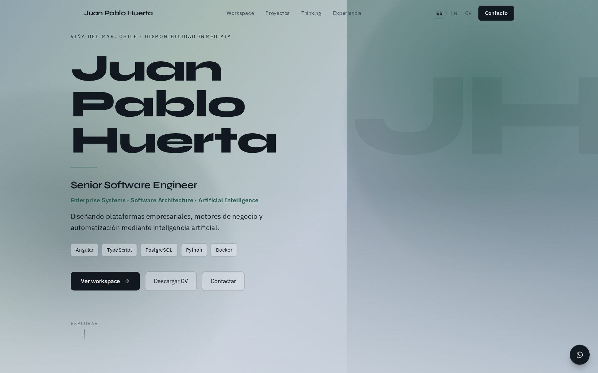
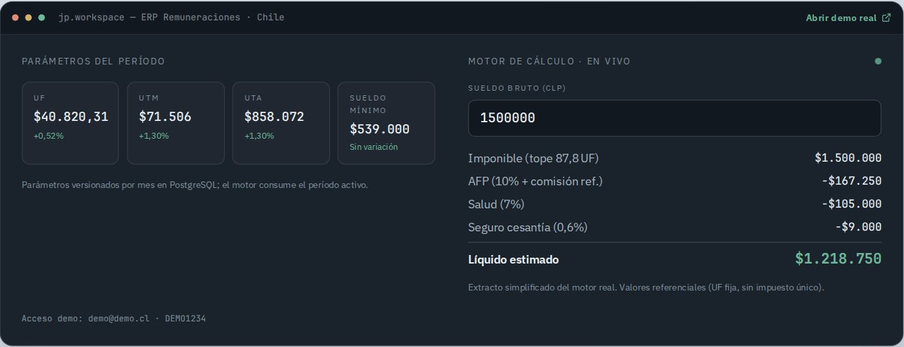

# JP·Workspace

> No es una colección de proyectos. Es una demostración interactiva de cómo un Senior Software Engineer piensa, diseña y construye sistemas empresariales.

**Live:** [jphuerta.vercel.app](https://jphuerta.vercel.app/) · **Demo del ERP:** [erp-beta-bay.vercel.app](https://erp-beta-bay.vercel.app/) (`demo@demo.cl` / `DEMO1234`)



## La idea

Cada componente **demuestra** una capacidad profesional en vez de describirla, y responde una sola pregunta:

| Sección | Pregunta | Cómo lo demuestra |
|---|---|---|
| Hero | ¿Quién es? | Posicionamiento, años y stack escaneables en 5 segundos |
| Workspace | ¿Qué construye? | Motor de cálculo de remuneraciones **ejecutándose en vivo**, alimentado por parámetros del período (UF/UTM/UTA) |
| Proyectos | ¿Cómo resuelve problemas? | Showcase lista→detalle con problema, solución y diagrama de arquitectura por capas |
| Thinking | ¿Cómo decide? | 6 registros de decisión estilo **ADR**: problema, opciones, decisión, trade-offs, resultado |
| Experiencia | ¿Dónde lo aplicó? | Accordion con responsabilidades e impacto por cargo |
| Footer | ¿Cómo contactarlo? | Email, LinkedIn, GitHub, WhatsApp, disponibilidad |



## Qué tiene de particular

- **Motor en vivo** — la vista Motor no es un mock: ejecuta un extracto real del cálculo chileno de liquidaciones (tope imponible 87,8 UF, AFP, salud, seguro de cesantía) en TypeScript puro.
- **ES / EN sin librerías** — todo el contenido vive en diccionarios tipados ([`content.es.ts`](src/app/content/content.es.ts) / [`content.en.ts`](src/app/content/content.en.ts)) servidos por un `LanguageService` con persistencia en `localStorage` y detección del idioma del navegador. El `<title>` y las metas cambian con el idioma.
- **Paleta disciplinada** — un solo acento verde, usado únicamente como indicador fino (líneas, texto); nunca como caja rellena.
- **Accesibilidad de movimiento** — todas las animaciones respetan `prefers-reduced-motion`.
- **Sin librerías de UI ni de animación** — Angular 15 + Tailwind CSS y nada más. Los reveals usan `IntersectionObserver`; las transiciones son CSS.
- Abre la consola del navegador: hay un saludo para quien inspecciona.

## Stack

Angular 15 · TypeScript 4.9 · Tailwind CSS 3 · Desplegado en Vercel

## Desarrollo

```bash
npm install
npm start        # http://localhost:4200
npm run build    # producción → dist/jp-workspace
```

## Estructura

```
src/app/
├── content/            # SiteContent tipado + diccionarios ES/EN (todo el copy vive aquí)
│   ├── content.model.ts
│   ├── content.es.ts
│   └── content.en.ts
├── services/
│   └── language.service.ts   # idioma activo + <title>/meta del documento
├── components/
│   ├── erp-workspace/  # chrome de producto: parámetros del período + motor en vivo
│   ├── navbar/         # navegación + toggle ES/EN
│   └── footer/         # contacto (#contacto)
└── app.component.*     # hero, proyectos, thinking, experiencia
```

Para ajustar contenido (proyectos, ADRs, experiencia, chips) basta editar los diccionarios en `src/app/content/` — no hay copy en los templates.

## Deploy

Vercel detecta Angular automáticamente. Si el output directory está configurado a mano, debe apuntar a `dist/jp-workspace`.

---

© Juan Pablo Huerta · [LinkedIn](https://www.linkedin.com/in/jphuerta1/) · [GitHub](https://github.com/teckuro)
